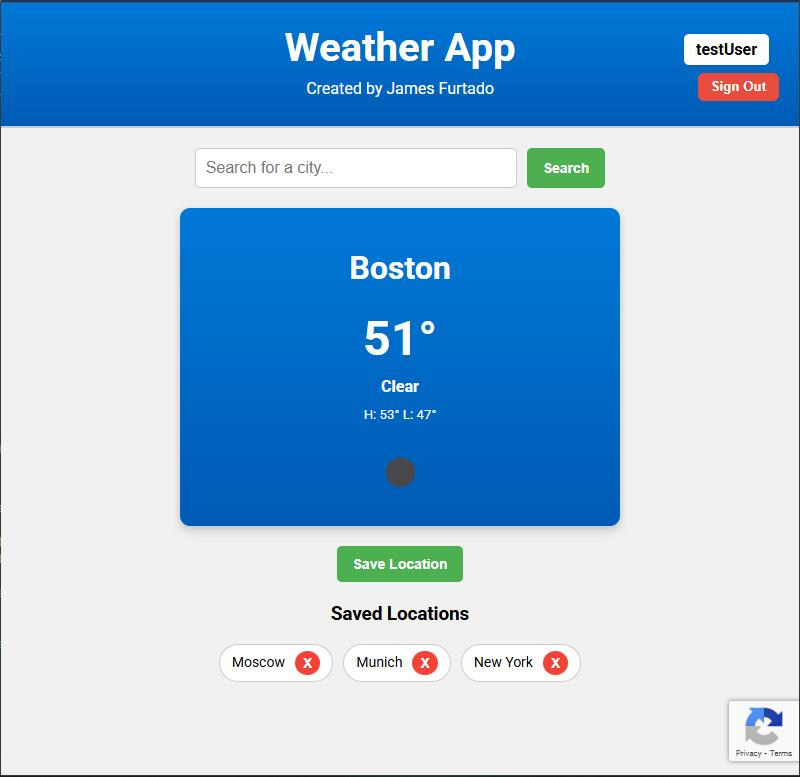
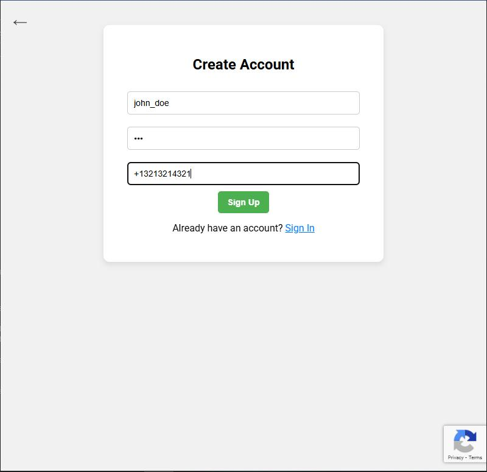
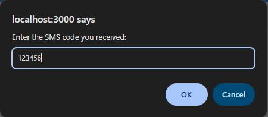

# 🌤️ Weather App - Full Stack Weather Service

My **Weather App** is a full-stack weather forecasting application that allows users to view real-time weather data, save favorite locations, and securely sign up with SMS-based two-factor authentication.

I built this project to strengthen my full-stack development skills — with a focus on React, REST APIs, and database management.

---

## ⚙️ Tech Stack

- **Frontend:** React.js
- **Backend:** Java Spring Boot
- **Database:** MySQL
- **Authentication:** Firebase Phone Auth

--- 

## 🛠️ Features & Demonstration

### 🌤️ Homepage – Live Weather + Saved Locations

Here is what the homepage looks like!

---

### 🔐 Secure Authentication

Users sign up with a username, password, and phone number.

The phone number and password are SHA-256 encrypted within the MySQL database.

---

### 📱 Two-Factor Authentication

Upon login/signup, users are sent a verification code via SMS, using Firebase Phone Auth.

*I know, I know-- it isn't that pretty... But it works!*

---

## 👤 Author

James Furtado  
[jamesdfurtado@gmail.com](mailto:jamesdfurtado@gmail.com)  
[linkedin.com/in/james-furtado](https://linkedin.com/in/james-furtado)

